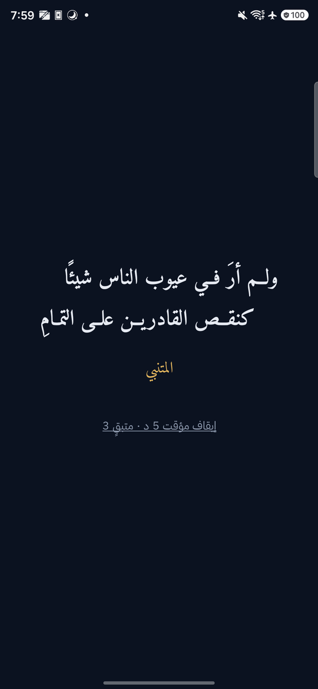
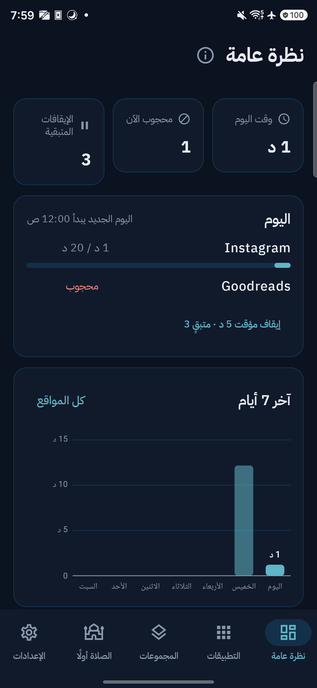
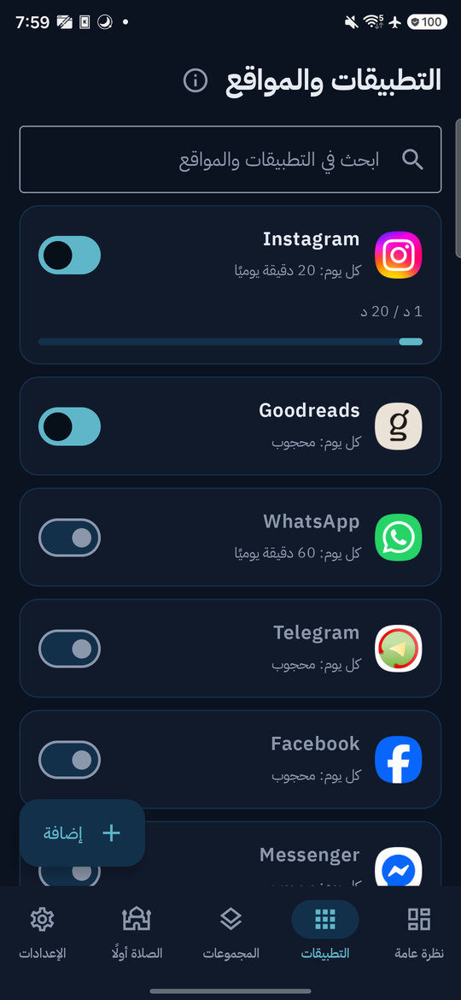
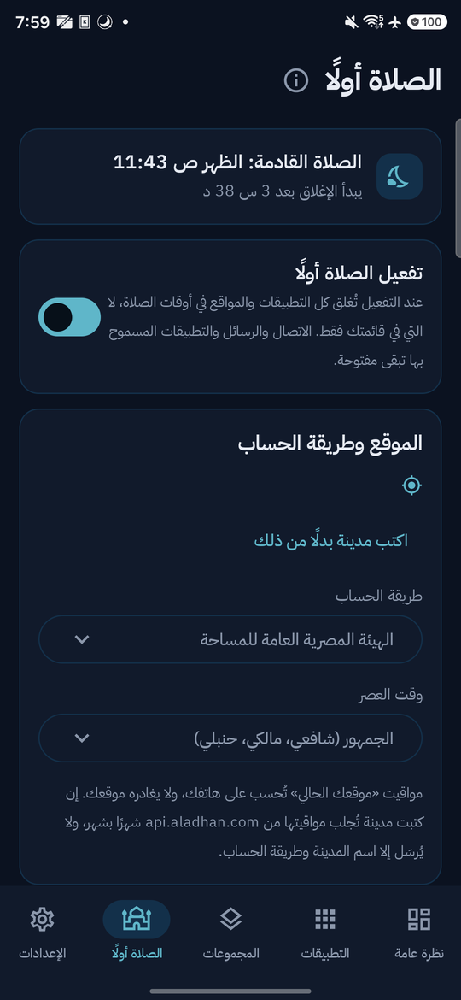
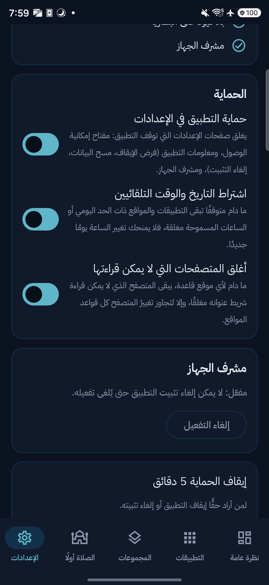

<div align="center">


# الوقت سيف · Time Is a Sword — Android

**تطبيق أندرويد يحمي وقتك: يحجب التطبيقات والمواقع المشتّتة أو يحدّ وقتها، ويغلق كل شيء وقت الصلاة، ويذكّرك بقيمة الوقت.**
<br>
An Android app that guards your time: it blocks or time-limits distracting apps and websites, closes everything at prayer time, and reminds you of the value of time.

[](LICENSE)


[العربية](#العربية) · [English](#english)







</div>

---

<div dir="rtl" align="right">

## العربية

> «نعمتان مغبون فيهما كثير من الناس: الصحة والفراغ» — رواه البخاري

**الوقت سيف** نسخة أندرويد من [إضافة المتصفح](https://github.com/mahm0udnasr/time-is-a-sword) التي تحمل الاسم نفسه. تختار التطبيقات والمواقع التي تأخذ وقتك، وتضع لكلٍّ منها قاعدته، فيحسب التطبيق وقتك الفعلي، وحين ينتهي الوقت يُغلقها ويعرض لك حديثًا أو أثرًا أو بيت شعر عن قيمة الوقت.

### المميزات

- **التطبيق وموقعه شيء واحد:** إنستغرام مثلًا هو التطبيق و instagram.com معًا، بوقت واحد مشترك.
- **قواعد لكل يوم:** حجب دائم، أو حد يومي بالدقائق، أو ساعات مسموحة فقط، أو الاثنان معًا.
- **المجموعات:** تطبيقات تتشارك وقتًا واحدًا (مثل واتساب وتيليجرام).
- **حساب دقيق:** يُحسب الوقت فقط والتطبيق أمامك والشاشة مفتوحة، ولا يُحسب مرتين.
- **تنبيهات** قبل 5 دقائق ثم دقيقة، و**شاشة حجب** بتذكير واحد، والشعر أبيات بشطرين ممدودين بالكشيدة.
- **الصلاة أولًا:** قبل كل صلاة بدقائق يُغلق كل تطبيق إلا المسموح به (الاتصال والرسائل والساعة… وما تضيفه كالمصحف)، وكل موقع، ثم يُفتح بعد الصلاة. المواقيت تُحسب على الهاتف من موقعك، أو تُجلب لمدينة تكتبها.
- **حاجز ضد التحايل:** أي تخفيف للقواعد يحتاج عدًّا تنازليًا 30 ثانية وكتابة تذكير كما هو دون لصق. وصفحات التطبيق في الإعدادات محميّة، ولا يُلغى تثبيته إلا بعد إلغاء «مشرف الجهاز»، وتغيير الساعة لا يمنحك يومًا جديدًا، والمتصفحات التي لا يقرؤها التطبيق تُغلق ما دامت للمواقع قواعد.
- **إيقاف مؤقت محدود:** 5 دقائق، 3 مرات في اليوم، بالحاجز نفسه.
- **معالج أول تشغيل** يرشدك خطوة خطوة، وإشعار بالوقت المتبقي، ونسخة احتياطية، وعربية أولًا مع الإنجليزية، ووضع فاتح وداكن.

### التثبيت

التطبيق ليس على متجر جوجل؛ يُثبَّت من ملف APK.

1. من صفحة [الإصدارات](https://github.com/mahm0udnasr/time-is-a-sword-android/releases) حمّل `time-is-a-sword-<الإصدار>.apk` (وتأكد إن شئت من بصمته SHA-256 المكتوبة في الإصدار).
2. افتحه من «ملفاتي» واسمح لتطبيق الملفات بتثبيت التطبيقات إن سُئلت.
3. افتح التطبيق واتبع المعالج. عند خطوة **إمكانية الوصول** قد تجد المفتاح رماديًا مع رسالة «لأمانك، هذا الإعداد غير متاح حاليًا»؛ هذا طبيعي لكل تطبيق مثبّت من ملف:
   - حاول تشغيله مرة، ثم ارجع.
   - الإعدادات › التطبيقات › الوقت سيف › ⋮ (أعلى الشاشة) › **السماح بالإعدادات المقيدة**، وأكّد برمزك.
   - ارجع إلى إمكانية الوصول وشغّل «الوقت سيف».
4. أكمل باقي الخطوات: الإشعارات، والبطارية بلا قيود، ومشرف الجهاز (يُنصح به).

**سامسونج:** أضف التطبيق في الإعدادات › البطارية › حدود استخدام الخلفية › **التطبيقات التي لا تنام أبدًا**. ولا تفعّل «الحماية المتقدمة» في أندرويد 16+ لأنها توقف خدمات إمكانية الوصول.

### الأذونات

| الإذن | لماذا |
|---|---|
| خدمة إمكانية الوصول | لمعرفة التطبيق الظاهر والموقع المفتوح في المتصفح، وللحجب، ولحماية صفحات التطبيق في الإعدادات. لا يُحفظ منها شيء ولا يُرسل. |
| مشرف الجهاز (اختياري) | حتى لا يُلغى التثبيت في لحظة ضعف. لا يستخدم أي صلاحية أخرى. |
| الإشعارات | الوقت المتبقي اليوم، وتنبيه إن توقفت الحماية. |
| المنبهات الدقيقة | ليبدأ الحجب وقفل الصلاة في ثانيته. |
| تجاهل تحسين البطارية | حتى لا يوقف النظام الحماية. |
| الموقع التقريبي | فقط عند ضغط «استخدم موقعي» في الصلاة أولًا. |
| الإنترنت | فقط لجلب مواقيت مدينة تكتبها. |

### الخصوصية

([سياسة الخصوصية](PRIVACY.md)) كل بياناتك تبقى على هاتفك: لا خوادم ولا تحليلات ولا حسابات. الاستثناء الوحيد: إن كتبت مدينتك في «الصلاة أولًا» يُرسَل اسمها إلى [api.aladhan.com](https://aladhan.com/prayer-times-api) مرة في الشهر تقريبًا. أما «استخدم موقعي» فيحسب المواقيت على الهاتف ولا يرسل موقعك.

### إن حدث خطأ

المخرج المشروع من داخل التطبيق: **الإعدادات › الحماية › إيقاف الحماية 5 دقائق** (بعد خطوة التأكيد)، فتستطيع في هذه الدقائق إيقاف الخدمة وإلغاء مشرف الجهاز وإلغاء التثبيت.

وإن تعذّر ذلك:

1. **الوضع الآمن:** اضغط زر التشغيل مطولًا، ثم اضغط مطولًا على «إيقاف التشغيل» واختر «الوضع الآمن». تتوقف فيه التطبيقات التي ثبّتّها، فتلغي تثبيت التطبيق كالمعتاد (وإن طُلب فألغِ مشرف الجهاز أولًا من الإعدادات › الأمان › تطبيقات مشرف الجهاز). ملاحظة: الوضع الآمن يوقف كل خدمات إمكانية الوصول، فأعد تشغيل ما تحتاجه بعده.
2. **من حاسوب** مع تصحيح USB: الأوامر في [القسم الإنجليزي](#if-something-goes-wrong).

### البناء من المصدر

Android Studio حديث (JDK 17+)، ثم `./gradlew assembleDebug`، والاختبارات `./gradlew :core:test :app:testDebugUnitTest`. منطق القواعد كله في الوحدة `core` (Kotlin بلا أندرويد)، منقول من الإضافة ومطابق لها في 850 حالة اختبار.

### المطوّر


**محمود نصر**: طالب نظم معلومات الأعمال، ينتقل من تطوير الويب إلى تعلّم الآلة والذكاء الاصطناعي.
<br>
[الموقع الشخصي](https://mahm0udnasr.vercel.app/) · [GitHub](https://github.com/mahm0udnasr) · [LinkedIn](https://linkedin.com/in/mahm0udnasr) · [Telegram](https://t.me/mahm0udnasr) · [Kaggle](https://kaggle.com/mahm0udnasr)

لا تنسونا من صالح دعائكم.

</div>

---

## English

> “There are two blessings in which many people are deceived: health and free time.” — Sahih al-Bukhari

**Time Is a Sword** (الوقت سيف) is the Android version of the [browser extension](https://github.com/mahm0udnasr/time-is-a-sword) of the same name. Pick the apps and websites that eat your time and give each its own rule; the app measures the time you actually spend, and when time is up it closes them and shows a hadith, a saying of the salaf or a line of poetry about the value of time.

### Features

- **An app and its website are one target**, sharing one budget (e.g. the Instagram app + instagram.com).
- **Rules per weekday:** always blocked, a daily limit, allowed hours only, or both. **Groups** share one budget (e.g. WhatsApp + Telegram).
- **Accurate time:** counted only while the target is in front with the screen on and unlocked, never twice.
- **Warnings** at 5 and 1 minutes left; a **block screen** with one reminder, poetry set as verses stretched with kashida.
- **Salah First:** a few minutes before each prayer every app except an allowlist (calls, messages, clock… plus anything you add, like a Quran app) and every website closes, then opens again after it. Times are calculated on the phone from your location, or fetched for a city you type.
- **Anti-cheat:** loosening anything needs a 30-second countdown and typing a reminder exactly (no paste). The app's own Settings pages are guarded, uninstalling needs the device admin switched off first, moving the clock doesn't give you a new day, and browsers the app can't read stay closed while websites have rules.
- **Limited pauses:** 5 minutes, 3 times a day, behind the same step.
- **First-run wizard**, a status notification with time left, backup export/import, Arabic first with English, light and dark.

### Install

The app is not on Google Play; it installs from an APK.

1. From [Releases](https://github.com/mahm0udnasr/time-is-a-sword-android/releases), download `time-is-a-sword-<version>.apk` (optionally check its SHA-256 against the one in the release notes).
2. Open it from your file manager, allowing it to install apps if asked.
3. Open the app and follow the wizard. At the **Accessibility** step the switch may be greyed out (“For your security, this setting is currently unavailable”); that's normal for any app installed from a file:
   - Try to switch it on once, then go back.
   - Settings › Apps › Time Is a Sword › ⋮ (top corner) › **Allow restricted settings**, and confirm with your PIN.
   - Go back to Accessibility and switch Time Is a Sword on.
4. Finish the remaining steps: notifications, no battery restrictions, device admin (recommended).

**Samsung:** also add the app to Settings › Battery › Background usage limits › **Never sleeping apps**. Keep Android 16+ **Advanced Protection** off: it disables accessibility services of apps like this one.

### Permissions

| Permission | Why |
|---|---|
| Accessibility service | Sees which app is in front and the website open in a browser, blocks, and guards the app's pages in Settings. Nothing from it is stored or sent. |
| Device admin (optional) | So the app can't be uninstalled on a whim. It uses no other power. |
| Notifications | Time left today, and an alert if protection stops. |
| Exact alarms | Blocks and prayer locks start on the exact second. |
| Ignore battery optimisation | So the system doesn't stop the protection. |
| Approximate location | Only when you press “Use my location” in Salah First. |
| Internet | Only to fetch prayer times for a typed city. |

### Privacy

Everything stays on your phone: no servers, no analytics, no accounts. The one exception: if you type a city in Salah First, its name is sent to [api.aladhan.com](https://aladhan.com/prayer-times-api) about once a month. “Use my location” calculates the times on the phone and never sends your location. Full details: [privacy policy](PRIVACY.md).

### If something goes wrong

The legitimate way out is inside the app: **Settings › Protection › Turn off protection for 5 minutes** (after the confirmation step). During those minutes you can switch off the service, deactivate the device admin and uninstall normally.

If that isn't possible:

1. **Safe Mode:** hold the power button, long-press *Power off* and tap *Safe mode*. Apps you installed are switched off there, so you can uninstall this one normally (if asked, first deactivate it in Settings › Security › Device admin apps). Note: Safe Mode switches off every accessibility service; switch the ones you use back on afterwards.
2. **From a computer** with USB debugging on:

   ```sh
   adb shell settings put secure enabled_accessibility_services ""
   adb shell dpm remove-active-admin com.mahm0udnasr.sword/.admin.SwordDeviceAdmin
   adb uninstall com.mahm0udnasr.sword
   ```

   The first line switches off **every** accessibility service; switch your other ones back on afterwards.

### Known limitations

Links opened inside an app's own browser (Instagram's in-app browser, for example) can't be read, so block the app itself. Notifications from blocked apps still arrive. Picture-in-picture windows can't always be closed. Apps in Secure Folder / Private Space may be invisible to the service.

### Build from source

A recent Android Studio (JDK 17+), then `./gradlew assembleDebug`; tests: `./gradlew :core:test :app:testDebugUnitTest`. All rule logic lives in the `core` module (plain Kotlin, no Android), ported from the extension and checked against it in 850 parity cases.

### Contributing

Found a bug or have an idea? [Open an issue](https://github.com/mahm0udnasr/time-is-a-sword-android/issues). Browsers' address-bar ids and Settings texts live in data files (`app/src/main/assets/browsers.json`, `guard.json`) so they can be fixed for other phones without code changes.

### Credits

[Amiri](https://github.com/aliftype/amiri) and [IBM Plex Sans Arabic](https://github.com/IBM/plex) fonts (SIL OFL) · [Adhan](https://github.com/batoulapps/adhan-java) prayer times (MIT) · [Simple Icons](https://simpleicons.org) (CC0) · [Material Icons](https://fonts.google.com/icons) (Apache 2.0) · city prayer times by the [Aladhan API](https://aladhan.com/prayer-times-api). See [THIRD_PARTY_NOTICES.md](THIRD_PARTY_NOTICES.md).

### Author


**Mahmoud Nasr**: BIS student, transitioning from web development to machine learning & AI.
<br>
[Website](https://mahm0udnasr.vercel.app/) · [GitHub](https://github.com/mahm0udnasr) · [LinkedIn](https://linkedin.com/in/mahm0udnasr) · [Telegram](https://t.me/mahm0udnasr) · [Kaggle](https://kaggle.com/mahm0udnasr)

<br clear="left">

### License

[MIT](LICENSE) © 2026 Mahmoud Nasr. Fonts and icons keep their own licences (see [THIRD_PARTY_NOTICES.md](THIRD_PARTY_NOTICES.md)).
